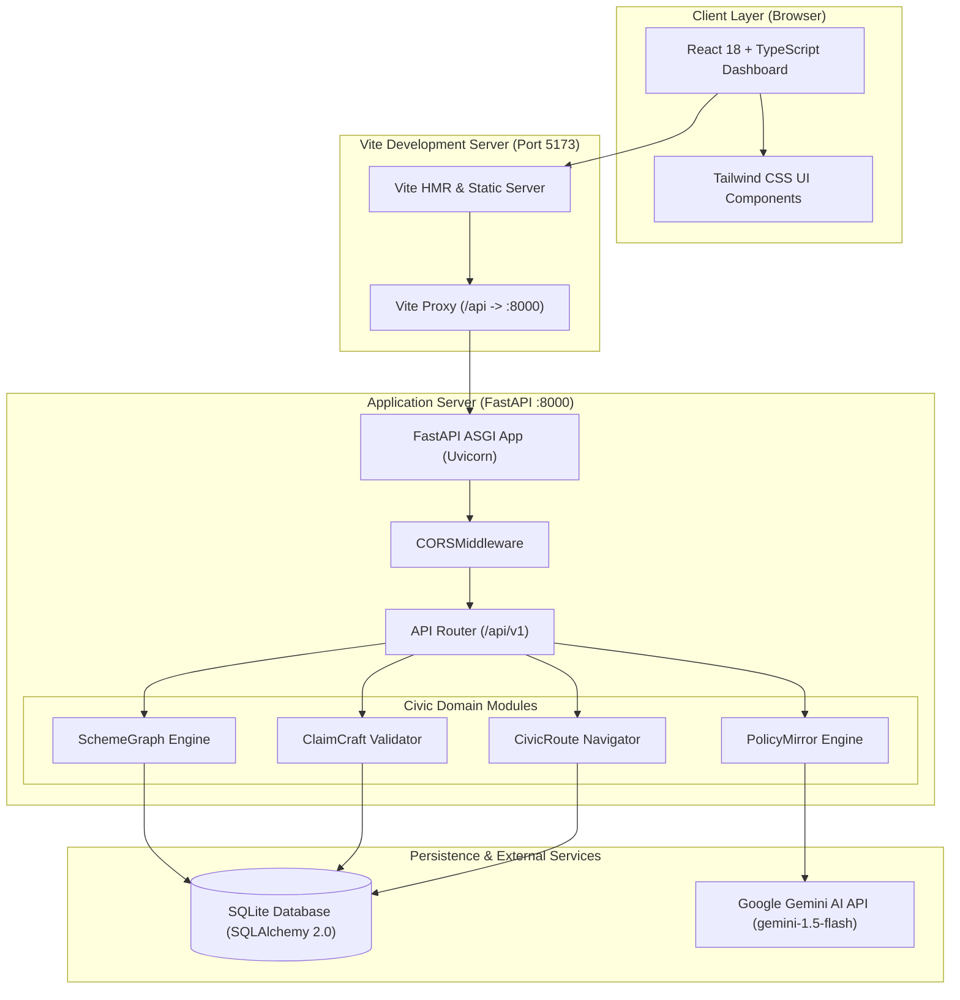

# NagrikLens System Architecture

## 1. Executive Summary

**NagrikLens** is an open civic technology platform engineered for a 48-hour hackathon. The system democratizes citizen access to public entitlements, welfare schemes, procedural navigation, and policy comprehension.

The platform is structured into four core modules:
1. **SchemeGraph**: Discovery engine and knowledge graph for government welfare eligibility and scheme relationships.
2. **ClaimCraft**: Entitlement assistant validating prerequisites, required documentation, and claim readiness.
3. **CivicRoute**: Navigational hierarchy mapping administrative authorities, service-level agreements (SLAs), and grievance escalation trees.
4. **PolicyMirror**: Plain-language civic policy analysis and impact simulator powered by Gemini AI.

---

## 2. System Architecture Diagram

---

## 3. Technology Stack & Selection Rationale

| Layer | Technology | Rationale |
|---|---|---|
| **Frontend Framework** | React 18 + TypeScript | Type safety, predictable state management, rich component ecosystem for fast hackathon iterations. |
| **Frontend Build Tool** | Vite | Instant Hot Module Replacement (HMR), lightweight build footprint, built-in development API proxy. |
| **Styling** | Tailwind CSS | Utility-first CSS ensuring rapid responsive design without custom CSS bloat. |
| **Backend Framework** | Python 3 + FastAPI | High performance asynchronous REST API, automatic OpenAPI/Swagger documentation, fast prototyping with Pydantic v2. |
| **ORM / Data Access** | SQLAlchemy 2.0 | Explicit session management, future migration flexibility, zero external service dependency during local dev. |
| **Database** | SQLite 3 | Embedded single-file storage with zero installation friction, perfect for 48-hour development and portable evaluations. |
| **Testing** | Pytest + HTTPX | Fast, isolated unit and integration tests with transactional in-memory database rollbacks. |
| **Generative AI** | Google Gemini API (`gemini-1.5-flash`) | Low-latency, cost-effective plain-language policy summarization and structured schema extraction. |

---

## 4. Domain Module Boundaries

### 4.1 SchemeGraph
- **Responsibility**: Ingestion, modeling, and relationship resolution for welfare schemes.
- **Data Model**: `Scheme`, `EligibilityCriterion`, `BenefitCategory`, `SchemeDependency`.
- **Constraint**: All scheme requirements are verified against structured rule definitions without fabricating government endpoints.

### 4.2 ClaimCraft
- **Responsibility**: Guiding citizens through entitlement application prep and document readiness.
- **Data Model**: `DocumentRequirement`, `ClaimChecklist`, `VerificationResult`.
- **Constraint**: Distinguishes verified proofs from self-declarations.

### 4.3 CivicRoute
- **Responsibility**: Routing municipal and civic grievances to responsible jurisdictions and generating escalation timelines.
- **Data Model**: `Department`, `Jurisdiction`, `EscalationTier`, `SlaRule`.
- **Constraint**: Encodes statutory citizen charters and contact channels accurately.

### 4.4 PolicyMirror
- **Responsibility**: Digesting legislative notifications and gazettes into citizen-actionable summaries.
- **Workflow**: Citizen inputs text or selects notification ➔ Pydantic prompt guard ➔ Gemini API ➔ Structured impact summary.

---

## 5. Security & Development Principles

1. **Zero Simulated Government Data**: Never represent mock mock-data as a live government feed. Schema models represent authentic criteria templates.
2. **Strict Secret Isolation**: Secrets (e.g. `GEMINI_API_KEY`, database credentials) reside exclusively in `.env` and are strictly ignored by Git.
3. **CORS Isolation**: Controlled origins configured through `app/core/config.py`.
4. **Isolated Test Execution**: Unit tests execute on SQLite `:memory:` with automatic transaction rollback to prevent state leakage.
